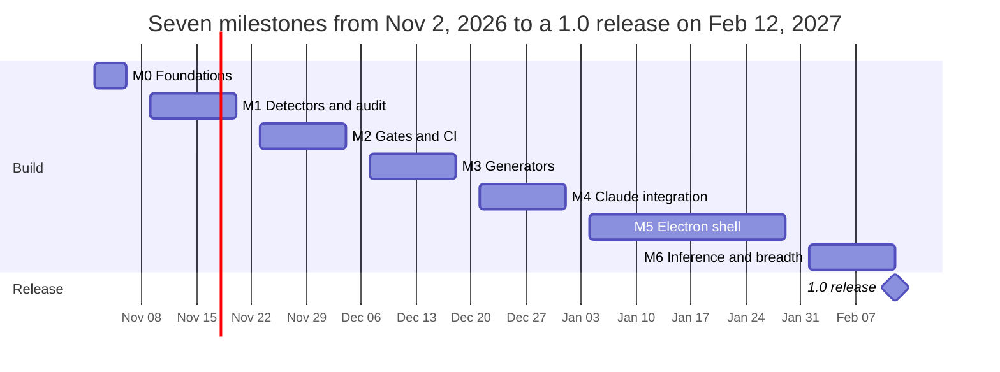

# Software Factory Build Plan

Oct 25, 2026 · @Aryan B.

## How to use this plan

This plan takes a solo full-stack developer from an empty repo to a 1.0 software factory in seven milestones over about 15 part-time weeks. Each milestone has a goal, the work broken into tasks, the files it produces, and a definition of done you can verify by running a command.

Conventions used throughout:

- **Task lists** are checkboxes. Tick them in this doc as you go; it is the progress tracker.
- **Done means runnable.** Every milestone ends with a command that must pass. If you cannot run it, the milestone is not done.
- **Dogfood from day one.** The factory repo carries its own `.factory/` directory and audits itself in CI. Every feature you build is tested first on the factory itself, then on one of your real repos.
- **Headless first.** Nothing lives only in the Electron shell. If the CLI cannot do it, the shell cannot either.
- **Controls are data, code is the engine.** Adding a new discipline later should mean adding YAML, not TypeScript.

Reading order: read Product definition and Milestone 0 fully before starting. Read each later milestone when you reach it. Keep the Control catalog section open while doing Milestones 1 and 6. Review Risks every two weeks.

Naming: the working name is `factory`; the npm scope is `@yourorg` (replace with your GitHub org or username). The target repo means any repo the factory is installed into; the factory repo means the one you build it in.

## Product definition

The factory is an auditor and scaffolder for GitHub repositories. Given a repo and a profile describing what the project is and what risks it carries, it computes which controls apply, checks which are satisfied, reports the gaps by phase and discipline, and generates the fixes as pull requests. It works identically on an empty repo and a half-built one.

**What it is**

- A control catalog (YAML) covering every discipline: repo hygiene, development, testing, security, accessibility, legal, cloud, CI/CD, observability, data, performance, UX, documentation, product.
- A headless engine (TypeScript) that resolves a profile, runs detectors, evaluates gates, and runs generators.
- Four clients over that engine: a CLI, a GitHub Action, a Claude Code skill, and an Electron desktop shell.
- A Claude integration that drafts the documents and code humans would otherwise forget (ADRs, threat models, runbooks, test scaffolds) and leaves them as reviewable PRs.

**What it is not**

- Not a project-management tool. It tracks controls and gates, not tickets. It links out to GitHub Issues.
- Not a replacement for GitHub's own features. Where GitHub has a native mechanism (rulesets, Dependabot, required checks), the factory configures it rather than reimplementing it.
- Not an authority on legal, security sign-off, or accessibility conformance. Those controls require named human evidence.
- Not Backstage. Backstage is for teams running a developer portal; this is a tool one developer installs in an afternoon.

**Guiding principles**

1. The repo is the source of truth. All shared state lives in `.factory/` inside the target repo; the app stores only personal preferences.
2. Every control cites the standard it comes from. No control without a `references` entry.
3. Automate detection where possible, require evidence where not, and never fake either.
4. Waivers are first-class. A control you cannot or will not satisfy gets a waiver with a reason, an owner, and an expiry, never a disabled check.
5. Generators are idempotent and never overwrite files a human edited.
6. Claude drafts, humans sign. Every AI output is a PR or a draft flagged for review.

**The one user**

You: a solo full-stack developer who moves between projects, sometimes starting fresh and sometimes inheriting a half-built repo. You want to open a repo and see, in under a minute, what is missing and what to do next. You do not want to maintain a compliance program; you want the compliance program to maintain itself.

**Success criteria for 1.0**

- `factory audit` on any of your repos runs in under 60 seconds locally and produces a report you agree with.
- `factory init` on an empty repo yields a passing scaffold gate in one command.
- A half-built repo gets a correct phase inference and a prioritized list of what remains.
- The factory passes its own gates in CI.
- A second person with repo access installs the Electron shell from GitHub Releases and audits a repo without reading the README.

## Milestone 0: foundations (week 1)

Goal: a monorepo that builds, tests, lints, and releases nothing yet, with the four architectural decisions written down so you never relitigate them.

**Decisions to record as ADRs before writing code**

| ADR | Decision | Why |
| --- | --- | --- |
| 0001 | Engine is headless; CLI, Action, skill, and Electron are thin clients | Lets CI enforce gates; keeps the shell optional |
| 0002 | Controls are YAML data validated by a zod schema | Adding a discipline means adding files, not code |
| 0003 | Shared state lives in `.factory/` in the target repo; personal state in the app | Teammates and CI see the same config |
| 0004 | Generators open PRs, never write to the default branch | Every change is reviewable and revertible |
| 0005 | TypeScript everywhere, pnpm workspaces, Node 22 LTS | One language across engine, CLI, and Electron |

**Tasks**

- [ ] Create the `factory` repo (private is fine). Enable Issues, Discussions off, Wiki off.
- [ ] `pnpm init`, `pnpm-workspace.yaml` listing `packages/*` and `apps/*`.
- [ ] Packages (empty for now): `packages/catalog`, `packages/engine`, `packages/cli`, `packages/action`, `packages/skill`, `apps/desktop`.
- [ ] Root tooling: TypeScript 5.x strict with project references; Vitest; ESLint flat config with `typescript-eslint`; Prettier; `.editorconfig`; `.nvmrc` or `.node-version`.
- [ ] Changesets for versioning and changelogs across packages.
- [ ] Conventional commits enforced with commitlint + a `commit-msg` hook (lefthook or husky).
- [ ] Pre-commit hook: lint-staged running ESLint, Prettier, and gitleaks.
- [ ] `docs/adr/` with ADR-0001 through 0005 in the MADR format.
- [ ] `README.md` with the one-paragraph pitch and the dev setup; `CONTRIBUTING.md`; `SECURITY.md`; `LICENSE` (pick now: MIT if you might open-source it, proprietary notice if not); `CODEOWNERS` with you.
- [ ] `.github/workflows/ci.yml`: install with pnpm cache, typecheck, lint, test, build, on PR and on push to `main`.
- [ ] Repo ruleset on `main`: require PR, require `ci` status check, block force-push, require linear history.
- [ ] Renovate app installed with a config that groups minor/patch updates weekly and pins GitHub Actions by SHA.
- [ ] Devcontainer definition so a fresh clone works in Codespaces or VS Code.
- [ ] `.factory/profile.yml` for the factory itself (type: `cli-and-desktop`, flags: `open-source: maybe`, `handles-pii: false`, `distributes-binaries: true`). It will be invalid until M1 defines the schema; write it anyway as the first fixture.

**Repo layout at the end of M0**

```
factory/
  .factory/profile.yml
  .github/workflows/ci.yml
  .changeset/
  docs/adr/0001-headless-engine.md ... 0005-typescript-pnpm.md
  packages/catalog/     (empty package.json)
  packages/engine/
  packages/cli/
  packages/action/
  packages/skill/
  apps/desktop/
  package.json  pnpm-workspace.yaml  tsconfig.base.json  eslint.config.js  .editorconfig
```

**Definition of done**

- `pnpm install && pnpm typecheck && pnpm lint && pnpm test && pnpm build` passes locally and in CI on a PR.
- A commit with a non-conventional message is rejected locally.
- A commit containing a fake AWS key is rejected by gitleaks locally.
- Five ADRs merged.

## Milestone 1: control schema, detectors, first audit (weeks 2–3)

Goal: `factory audit` runs against a local clone plus the GitHub API and prints a lane-by-lane table of pass, fail, and needs-evidence, for about 40 controls.

**The control schema** (`packages/catalog/src/schema.ts`, zod; JSON Schema generated from it for editor autocomplete)

```yaml
id: sec.secret-scanning.pre-commit        # lane.topic.name, stable forever
title: Secret scanning runs before commit
lane: security                            # one of the 14 lanes
phase: scaffold                           # discovery | requirements | architecture | design | scaffold | build | harden | launch | operate
severity: high                            # critical | high | medium | low
applies:                                  # predicate over the profile; omit = always
  all: [{ flag: has-source-code }]
detect:                                   # one or more; all must pass
  - type: file-matches
    path: ".pre-commit-config.yaml|lefthook.yml|.husky/pre-commit"
    pattern: "gitleaks"
evidence: none                            # none | optional | required (human attaches link/hash)
fix:
  type: template
  template: hooks/gitleaks
references:
  - { name: OpenSSF Scorecard, url: https://github.com/ossf/scorecard, section: Token-Permissions }
rationale: >
  Leaked credentials are the most common cause of repo compromise; catching them
  before push is cheaper than rotating them after.
```

**Detector types to implement** (`packages/engine/src/detectors/`), each a pure function `(ctx) => DetectorResult` with `pass | fail | skip` plus a message and optional remediation hint:

| Type | Checks | Needs |
| --- | --- | --- |
| `file-exists` | glob matches at least one file | local clone |
| `file-matches` | file content matches regex | local clone |
| `file-json-path` / `file-yaml-path` | a path in a JSON/YAML file exists or equals a value (workflow steps, package.json scripts, tsconfig flags) | local clone |
| `github-api` | REST/GraphQL query against the repo: rulesets, Dependabot enabled, secret scanning, default branch, visibility, Actions permissions | token |
| `command` | runs a tool, parses exit code or JSON output (e.g. `scorecard --format json`, `trivy`, `license-checker`) | tool installed, or run in a container |
| `scorecard` | imports a named OpenSSF Scorecard check result | `command` under the hood |
| `manual` | always `needs-evidence`; passes when `evidence.yml` has a dated entry for this control | human |

**Engine pipeline** (`packages/engine/src/`)

1. `loadCatalog()` reads all YAML under `packages/catalog/controls/**`, validates each against the schema, rejects duplicates.
2. `buildContext(repoPath, token)` opens the clone (use `simple-git` for metadata, plain `fs` for files), builds a GitHub client (`octokit`) and caches API responses for the run.
3. `runDetectors(controls, ctx)` with a concurrency limit; each result carries control id, status, message, duration.
4. `report(results)` renders a table grouped by lane, then by phase; JSON output with `--json`; writes `.factory/state.json`.

Profile and applicability are M2; in M1 every control applies.

**Tasks**

- [ ] Write `schema.ts` and the JSON Schema export; add a `catalog:validate` script that fails CI on a bad control.
- [ ] Define the 14 lanes and 9 phases as enums with descriptions in `packages/catalog/src/taxonomy.ts`.
- [ ] Implement the seven detector types with unit tests against fixture repos in `packages/engine/test/fixtures/` (an empty repo, a minimal Node repo, a repo with everything).
- [ ] Implement `github-api` with response caching and a clear error when the token lacks scope.
- [ ] Write the first 40 controls: 10 hygiene, 8 development, 8 CI/CD, 10 security, 4 testing. Pull the exact list from the Control catalog section.
- [ ] `packages/cli`: commander-based `factory audit [path] [--json] [--lane x] [--token]`. Token from `GITHUB_TOKEN` env or the `gh` CLI's stored auth.
- [ ] Human-readable report with colors (`picocolors`), a summary line (`32 pass, 6 fail, 2 need evidence`), and exit code 1 on any `critical` failure.
- [ ] Run against the factory repo and three of your real repos; keep a `docs/audit-notes.md` of every false positive and fix the detector or the control.

**Definition of done**

- `pnpm factory audit .` on the factory repo completes in under 30 seconds and reports results for all 40 controls.
- The same command on three real repos produces zero false positives you cannot explain.
- `pnpm catalog:validate` catches a control with a missing `references` field.
- Detector unit tests cover every type with at least one pass, one fail, and one skip fixture.

## Milestone 2: profile, gates, waivers, CI action (weeks 4–5)

Goal: the factory knows what kind of project it is looking at, only applies the controls that matter, groups them into phase gates, lets you waive one with a reason, and fails a PR in CI when a gate is red.

**Profile** (`.factory/profile.yml`, schema in catalog)

```yaml
version: 1
name: my-app
type: web-app            # web-app | api | cli | library | mobile | desktop | data-pipeline | monorepo
stack: [typescript, react, postgres, aws]
phase: build             # set by `factory init`; later inferred (M6)
flags:
  public-facing: true
  has-users: true
  handles-pii: true
  handles-payments: false
  handles-health-data: false
  serves-minors: false
  eu-users: true
  enterprise-customers: false
  government-customers: false
  uses-ai: false
  open-source: false
  distributes-binaries: false
  multi-service: false
lanes:                   # optional per-lane toggle; default all on
  legal: on
  accessibility: on
severity-floor: medium   # ignore controls below this in reports
```

**Applicability predicates**: `all`, `any`, `not` over `{ flag }`, `{ type }`, `{ stack }`, `{ phase-at-least }`. Evaluate to a boolean per control; non-applicable controls show as `n/a` and never block a gate.

**Gates** (`packages/catalog/gates/*.yml`): one per phase, listing control ids (or `lane: x, severity: >= high` selectors) that must pass. A gate result is `green` (all pass or waived), `amber` (only `needs-evidence` outstanding), or `red`.

**Waivers** (`.factory/waivers.yml`)

```yaml
- control: a11y.screen-reader-pass
  reason: Internal tool, two users, both sighted; revisit before public launch
  owner: you@example.com
  created: 2026-11-02
  expires: 2027-02-01
```

Expired waivers count as failures. The report lists waivers expiring within 30 days.

**Evidence** (`.factory/evidence.yml`): entries of `control`, `url` or `sha256`, `reviewer`, `date`, `note`. A `manual` detector passes when an unexpired entry exists; evidence can carry a `valid-for: 365d` so threat models and pen tests age out.

**`factory init`**: interactive (prompts for type and flags with `@clack/prompts`), writes `profile.yml`, `waivers.yml` (empty), `evidence.yml` (empty), adds `.github/workflows/factory.yml`, runs the first audit, prints what to do next. Non-interactive with `--type web-app --flag handles-pii` for scripting.

**GitHub Action** (`packages/action`, composite action): sets up Node, installs the CLI from GitHub Packages, runs `factory audit --gate <phase from profile> --format github`, uploads the JSON report as an artifact, posts or updates one sticky PR comment with the gap summary (use `peter-evans/create-or-update-comment` or a small script), and fails the job when the gate is red. Workflow in the target repo:

```yaml
name: factory
on: [pull_request, push]
jobs:
  audit:
    runs-on: ubuntu-latest
    permissions: { contents: read, pull-requests: write }
    steps:
      - uses: actions/checkout@<sha>
      - uses: yourorg/factory/packages/action@v1
        with: { token: ${{ secrets.GITHUB_TOKEN }} }
```

**Tasks**

- [ ] Profile schema, loader, and `factory profile show | set <key> <value>`.
- [ ] Applicability evaluator with unit tests for every predicate combination.
- [ ] Gate definitions for all nine phases; `factory audit --gate build` and `--gate all`.
- [ ] Waiver loader, expiry handling, `factory waive <control> --reason --expires`.
- [ ] Evidence loader and `factory evidence add <control> --url|--file --note`.
- [ ] `factory init` interactive and flag-driven.
- [ ] Report formats: `table`, `json`, `markdown`, `github` (annotations via `::error` lines).
- [ ] Composite action, sticky PR comment, artifact upload.
- [ ] Factory repo setting: Actions access set to "Accessible from repositories in the organization" so private consumers can `uses:` it. Document this in the README.
- [ ] Publish `@yourorg/factory` to GitHub Packages from a release workflow driven by Changesets; tag `v1` and move it on each minor.
- [ ] Add the `factory.yml` workflow to the factory repo itself.

**Definition of done**

- Deleting `SECURITY.md` on a branch of the factory repo turns the PR check red with a comment naming the control.
- A waiver for that control with a future expiry turns it green; setting the expiry to yesterday turns it red again.
- `factory init` on a fresh empty repo produces a valid profile, a workflow, and a first report in one run.
- A second private repo in your org can `uses: yourorg/factory/packages/action@v1` successfully.

## Milestone 3: generators and remediation PRs (weeks 6–7)

Goal: `factory fix` turns red controls into a pull request containing the files and settings that satisfy them, without ever clobbering work a human did.

**Generator types** (`packages/engine/src/generators/`)

| Type | Does | Example |
| --- | --- | --- |
| `template` | renders files from `packages/catalog/templates/<name>/` with Eta or Handlebars, variables from the profile | `SECURITY.md`, `CODEOWNERS`, devcontainer |
| `merge-yaml` | inserts a path into an existing YAML file (a CI step, a Renovate rule) | add a `gitleaks` step to `ci.yml` |
| `merge-json` | same for JSON (`package.json` scripts, `tsconfig` flags) | add `"lint": "eslint ."` |
| `github-setting` | calls the GitHub API to set a ruleset, enable Dependabot, set Actions permissions | protect `main` |
| `command` | runs an installer (`npx playwright install`, `pnpm add -D vitest`) | add a test runner |
| `claude` | drafts content via Claude (M4) | threat model |

**Merge policy** (the part that makes it trustworthy)

1. Never overwrite a file that exists unless the control marks it `managed: true` (only for files the factory owns, like `.factory/state.json`).
2. For an existing file the generator wants to change, produce a minimal structural merge (YAML/JSON path insertion), never a textual overwrite. If the merge is ambiguous, write `<file>.factory-suggested` next to it and tell the user.
3. Record every generated file's hash in `.factory/state.json` so later runs can tell "unchanged since we wrote it" from "human edited it".
4. Every run is a dry run by default; `--write` applies locally, `--pr` applies on a branch and opens a PR titled `factory: <n> fixes for <gate>` with one commit per control.

**The scaffold phase generators to write** (these are the twenty files every repo needs)

- [ ] `README.md` skeleton with sections for setup, scripts, architecture link, and a factory badge
- [ ] `LICENSE` from a chosen SPDX id; `CONTRIBUTING.md`; `CODE_OF_CONDUCT.md` (Contributor Covenant); `SECURITY.md` with disclosure email and supported versions; `CODEOWNERS`
- [ ] `.editorconfig`, `.gitattributes`, `.gitignore` from stack
- [ ] `.github/PULL_REQUEST_TEMPLATE.md`, `ISSUE_TEMPLATE/bug.yml`, `ISSUE_TEMPLATE/feature.yml`
- [ ] `.github/workflows/ci.yml` for the detected stack (node, python, go, rust), with caching and SHA-pinned actions
- [ ] `.github/workflows/factory.yml`
- [ ] `renovate.json` with grouping and action pinning
- [ ] `.pre-commit-config.yaml` or `lefthook.yml` with gitleaks, formatter, linter
- [ ] `.devcontainer/devcontainer.json`
- [ ] `.env.example` and a note in README on secret handling
- [ ] `docs/` Diátaxis skeleton; `docs/adr/0000-use-adrs.md`; `docs/architecture/c4.md` with an empty Mermaid C4 block
- [ ] `docs/runbooks/README.md`, `docs/threat-model.md` placeholder (manual control until M4 drafts it)
- [ ] Ruleset on default branch via API: PR required, status checks required, no force-push
- [ ] Dependabot security updates on; secret-scanning push protection on where the plan allows

**Tasks**

- [ ] Template engine wrapper with a test that renders every template in the catalog against three profiles.
- [ ] YAML and JSON structural merge with round-trip-preserving parsers (`yaml` package with `keepSourceTokens`; `jsonc-parser` for JSON).
- [ ] Hash registry in `state.json`; a detector helper `managedFileUnchanged(path)`.
- [ ] `factory fix [--control id] [--gate phase] [--write | --pr]` with a dry-run diff preview.
- [ ] PR creation via Octokit on a branch `factory/<date>-<gate>`; reuse the open PR if one exists.
- [ ] Run `fix --pr` on the factory repo and on an old real repo; review the PR as if a stranger sent it.

**Definition of done**

- `factory init && factory fix --write` on an empty directory yields a repo whose `scaffold` gate is green.
- `factory fix --pr` on a repo with a hand-edited `ci.yml` adds the missing step without touching any other line (verify with the PR diff).
- Running `fix` twice produces no second diff.

## Milestone 4: Claude integration and the Claude Code skill (weeks 8–9)

Goal: the controls nobody fills in by hand (threat model, ADRs, runbooks, user stories, test scaffolds) get a credible first draft from Claude, delivered as a PR you edit rather than a blank page you avoid.

**Two surfaces, build both**

1. **Claude Code skill** (`packages/skill/`, copied by `factory init` into `.claude/skills/factory/`). A `SKILL.md` that teaches Claude Code when to run `factory audit --json`, how to read the gap report, and how to run `factory fix` or write the missing artifact itself. This is the cheapest path to agentic behaviour and needs no API key handling of your own.
2. **`claude` generator type** in the engine, calling the Messages API through the official SDK (`@anthropic-ai/sdk`). Used by the CLI (`factory ai <task>`) and the Electron shell. Key from `ANTHROPIC_API_KEY` or the shell's secure store; never stored in the repo.

**Context packer** (`packages/engine/src/ai/context.ts`): assembles profile, the gap report, the control's rationale and references, and a size-capped selection of repo files chosen by the task (for a threat model: `docs/architecture/*`, route files, auth modules, `docker-compose*`, IaC). Hard cap on tokens; list the files included in the PR description so the reviewer knows what Claude saw. Never include `.env*`, keys, or files matching gitleaks patterns.

**Prompt templates** live in the catalog next to the control (`packages/catalog/prompts/<task>.md`) with a system prompt, the output format, and a review checklist appended to the generated file as a comment block ("Reviewer: confirm X, Y, Z").

**Tasks for the first release** (each a `claude` generator wired to a control)

| Task | Control it satisfies | Output |
| --- | --- | --- |
| `brief` | `product.discovery-brief` | `docs/brief.md`: problem, users, success metrics, kill criteria |
| `stories` | `req.user-stories` | `docs/requirements/stories.md` with Gherkin acceptance criteria |
| `adr` | `arch.adr-log` | `docs/adr/NNNN-<slug>.md` from a one-line decision |
| `c4` | `arch.c4-diagrams` | Mermaid C4 context and container diagrams inferred from the code |
| `threat-model` | `sec.threat-model` | STRIDE table over the C4 model with proposed mitigations |
| `runbook` | `ops.runbook-per-alert` | runbook skeleton per detected alert or service |
| `explain-gaps` | none; report helper | prioritized narrative of what is missing and why, for this profile |
| `test-scaffold` | `test.unit-coverage-floor` | test files for uncovered modules, marked `todo` |
| `changelog` | `release.changelog` | release notes from conventional commits since last tag |
| `license-summary` | `legal.third-party-licenses` | plain-English summary of the license scan with conflicts flagged |

**Guardrails**

- Output always lands on a branch or as a draft file; `evidence` for these controls still requires a human entry, so a generated threat model does not pass the gate until someone reviews it.
- Each generated file starts with a header: generated by, date, model, files consulted, and a `reviewed-by:` line that is empty until a human fills it.
- Cost logging: every call appends tokens in/out and estimated cost to `.factory/ai-usage.log` (gitignored) so you can see what the month is costing.
- Use the Batch API for nightly or bulk jobs (`factory ai explain-gaps --all-repos`).

**Tasks**

- [ ] `packages/skill/SKILL.md` plus `scripts/` wrappers; test it by running Claude Code in a target repo and asking "what is left to do here?"
- [ ] SDK wrapper with retries, timeouts, token accounting, and model pinning in config.
- [ ] Context packer with include/exclude rules and a unit test that proves `.env` never gets in.
- [ ] Ten prompt templates; a fixture test that runs each against a recorded response to catch format drift.
- [ ] `factory ai <task> [--pr]`.
- [ ] Generated-file header and reviewer checklist convention.
- [ ] Usage log and `factory ai usage` summary.

**Definition of done**

- On a half-built real repo, `factory ai explain-gaps` produces a narrative you would send to a collaborator with minor edits.
- `factory ai threat-model --pr` opens a PR with a STRIDE table whose rows reference real components in the repo.
- Claude Code, with the skill installed, answers "what's left?" by running the audit rather than guessing.

## Milestone 5: Electron shell (weeks 10–13)

Goal: a desktop app that lists your repos, lets you edit a repo's profile with toggles, shows the lane scorecard and phase gates, runs audits and fixes with live logs, and renders the repo's docs. It ships as a signed-or-unsigned installer on the factory repo's Releases page. Do not start this milestone until you have used M1–M3 on real work for two weeks.

**Stack**: Electron 33+, Vite, React, TypeScript, `electron-vite` for the build, `electron-builder` for packaging, Tailwind plus a small component set (Radix or shadcn) for accessible primitives. The engine runs in the main process; the renderer never touches the filesystem, git, or the network directly.

**Security baseline for the app itself** (the factory audits this too)

- `contextIsolation: true`, `nodeIntegration: false`, `sandbox: true` on every `BrowserWindow`.
- A preload script exposing a typed, allow-listed API via `contextBridge`; IPC channels validated with zod on both sides.
- Content Security Policy header set to `default-src 'self'`; no remote content loaded in the renderer.
- GitHub token obtained by OAuth device flow (GitHub App or OAuth App you register), stored with `safeStorage`; Anthropic key the same way. Tokens never cross IPC; the renderer asks the main process to act.
- `shell.openExternal` only for allow-listed hosts (github.com, docs links from the catalog).
- Electron fuses set at package time (`runAsNode` off, `enableCookieEncryption` on).

**Screens**

| Screen | Shows | Actions |
| --- | --- | --- |
| Repos | repos from the GitHub API plus local clones you add; last audit date; gate color | add local folder, clone, remove |
| Profile | type, stack, flags, lane toggles, severity floor as form controls bound to `.factory/profile.yml` | save (commits to a branch or writes locally per setting), reset |
| Scorecard | 14 lanes as rows, pass/fail/evidence/waived/n-a counts, click to expand controls with rationale and references | run audit, filter by lane or severity |
| Gates | nine phases, current phase highlighted, red/amber/green per gate, what blocks each | waive with reason and expiry, attach evidence |
| Fix | dry-run diff of proposed changes grouped by control | apply locally, open PR |
| AI | list of AI tasks with cost estimate; runs stream into a log pane | run task, open resulting PR |
| Docs | renders `docs/` and `.factory/` Markdown with Mermaid; ADR list; threat model | open in editor |
| Settings (personal) | theme, keys, default org, update check | sign out |

**Personal versus shared state**: anything on the Profile, Gates, and evidence screens writes to the repo. Settings writes to `app.getPath('userData')`. There is no third place.

**Distribution**

- Release workflow on tag: build for macOS (arm64, x64), Windows, Linux; attach to the GitHub Release with a `latest.yml`/`latest-mac.yml` for `electron-updater`.
- Private factory repo: `electron-updater` cannot read private releases without a token, so v1 ships a manual "check for updates" that calls the Releases API with the user's token and links to the download. Revisit if the repo goes public.
- Code signing: optional for a team that trusts the repo (macOS users right-click Open once). Add Apple notarization and Windows signing before any wider audience.
- Installation doc in the README: download, first-run device-flow sign-in, add a repo.

**Tasks**

- [ ] Scaffold with `electron-vite`; wire main/preload/renderer with typed IPC and zod validation.
- [ ] Device-flow sign-in; `safeStorage` token store; sign-out clears it.
- [ ] Engine adapter in main: run audit/fix/ai as child tasks with progress events streamed over IPC.
- [ ] Repos, Profile, Scorecard, Gates screens.
- [ ] Fix and AI screens with log streaming and a diff viewer.
- [ ] Docs screen with Markdown and Mermaid rendering.
- [ ] Settings screen and manual update check.
- [ ] Keyboard navigation and screen-reader labels on every control; run axe in Playwright against the renderer.
- [ ] Playwright Electron tests for the three main flows: sign in and list repos, audit a repo, waive a control.
- [ ] `electron-builder` config, fuses, release workflow, first tagged release.

**Definition of done**

- A teammate installs from the Releases page, signs in, adds a repo, and sees a scorecard without help.
- Changing a flag on the Profile screen and saving produces a one-line diff in `.factory/profile.yml` in that repo.
- The app passes its own factory audit for the security and accessibility lanes.

## Milestone 6: phase inference, metrics, evidence, lane breadth (weeks 14–15)

Goal: the factory answers "where is this project and what is left?" for a repo it has never seen, shows how the project is performing, and covers every lane with real controls, not placeholders.

**Phase inference**: the inferred phase is the lowest phase whose gate is not green. `factory status` prints the phase, the blocking controls in severity order, and an estimate of effort (small/medium/large, tagged on each control). The profile's `phase` field becomes a floor you can set manually, never a ceiling. The Electron Gates screen highlights the inferred phase.

**Metrics** (`factory metrics`, and a dashboard panel in the shell), computed from the GitHub API with no extra services:

- DORA four keys: deployment frequency (releases or deploy workflow runs), lead time for changes (PR open to merge to deploy), change failure rate (deploys followed by a `hotfix`/`revert` within 24 h), time to restore (incident label open to close).
- Hygiene trend: pass count per lane per week, stored in `.factory/history.jsonl` on each CI run.
- Dependency age: count of outdated majors from Renovate's dashboard issue.

**Evidence workflow**: attach a URL or upload a file whose sha256 is recorded; evidence has `valid-for`; the report lists evidence expiring in 30 days; the shell shows an "attach" button on every `needs-evidence` row.

**Lane breadth**: write the remaining controls from the Control catalog section so every lane has coverage. The evidence-heavy lanes (legal, accessibility, operations, product) are mostly `manual` detectors with strong rationale text and references; that is correct, not a shortcut.

**Multi-repo**: `factory audit --all` over a list of repos in `~/.config/factory/repos.yml` (or the shell's repo list) producing one combined table; the Batch API variant of `explain-gaps` for all of them.

**Tasks**

- [ ] `factory status` with inference and effort tags; effort tag added to the control schema.
- [ ] History append in the Action; `factory metrics` with DORA calculations and documented assumptions.
- [ ] Evidence attach in CLI and shell; expiry warnings in reports.
- [ ] Write the remaining controls (target 120–150 total) and gate definitions for all phases.
- [ ] Multi-repo audit and dashboard.
- [ ] Catalog site: a build step that renders every control to Markdown under `docs/catalog/` so the catalog is browsable in GitHub.
- [ ] 1.0 release: Changesets major bump, tag `v1`, release notes, README refresh, installation video or GIF.

**Definition of done**

- `factory status` on a half-built real repo names the phase you would have named and lists the top five blockers you agree with.
- Every lane has at least six controls; every control has references and a rationale.
- `factory metrics` returns the four DORA numbers for the factory repo itself.
- The factory's own audit is fully green or waived with reasons.

## Control catalog by lane

This is the master list of controls to write. Each row is one YAML file. Detector and fix columns use the type names from Milestones 1 and 3; `manual` means a human attaches evidence. Phase is where the control first becomes required. Write the M1 set (marked with an asterisk) first; the rest land in M6. References name the standard each control is derived from; cite the exact section in the YAML.

**Repo hygiene and governance** (phase: scaffold; reference: OpenSSF Scorecard, GitHub docs)

| Control | Detector | Fix |
| --- | --- | --- |
| README present with setup section \* | file-matches | template |
| LICENSE present and SPDX-recognized \* | file-exists | template |
| CODEOWNERS covers root \* | file-exists | template |
| CONTRIBUTING.md present \* | file-exists | template |
| SECURITY.md with disclosure contact \* | file-matches | template |
| CODE_OF_CONDUCT.md present | file-exists | template |
| .editorconfig and .gitattributes present \* | file-exists | template |
| Lockfile committed \* | file-exists | command |
| Default branch protected: PR required, checks required, no force-push \* | github-api | github-setting |
| Signed commits or verified signatures required | github-api | github-setting |
| Conventional commits enforced \* | file-matches (hook config) | template |
| PR and issue templates present | file-exists | template |
| Toolchain version pinned (.nvmrc, .tool-versions, devcontainer) \* | file-exists | template |
| Dependency update bot configured (Renovate or Dependabot) \* | file-exists or github-api | template |
| GitHub Actions pinned by SHA | file-matches | merge-yaml |
| Workflow token permissions least privilege | file-yaml-path | merge-yaml |
| Stale branch policy documented | manual | claude |

**Development** (phase: scaffold/build; reference: Twelve-Factor, DORA capabilities)

| Control | Detector | Fix |
| --- | --- | --- |
| Linter configured and run in CI \* | file-exists + file-yaml-path | template + merge-yaml |
| Formatter configured and enforced \* | file-exists | template |
| Type checking strict and in CI \* | file-json-path | merge-json |
| Pre-commit hooks installed \* | file-exists | template |
| Structured logging library in use | file-matches | claude |
| Config from environment, `.env.example` present \* | file-exists | template |
| Feature flag mechanism present | file-matches | manual |
| Database migration tool with up/down | file-exists | manual |
| API contract committed (OpenAPI/GraphQL schema) | file-exists | claude |
| API versioning policy documented | manual | claude |
| Error tracking SDK initialized | file-matches | manual |
| OpenTelemetry instrumented | file-matches | manual |
| Health and readiness endpoints exist | file-matches | manual |
| i18n framework present (if public-facing) | file-matches | manual |
| Code review required (ties to ruleset) \* | github-api | github-setting |

**Testing** (phase: build; reference: Google SWE book testing chapters)

| Control | Detector | Fix |
| --- | --- | --- |
| Unit test runner configured and in CI \* | file-exists + file-yaml-path | template |
| Coverage reported with a ratcheting floor | file-json-path | merge-json |
| Integration tests against a real DB in CI | file-yaml-path | manual |
| Contract tests (if multi-service) | file-exists | manual |
| E2E tests for top journeys (Playwright) | file-exists | command |
| Visual regression on design system | file-exists | manual |
| Accessibility assertions in E2E (axe) | file-matches | merge-json |
| Mutation testing on core logic | file-exists | manual |
| Flaky test quarantine process | manual | claude |
| Test data factories and seed script | file-exists | claude |
| Load test script exists (k6) and run before launch | file-exists | manual |

**Security and supply chain** (phase: scaffold/harden; reference: OWASP ASVS, SLSA, OpenSSF Scorecard, NIST SSDF)

| Control | Detector | Fix |
| --- | --- | --- |
| Secret scanning pre-commit (gitleaks) \* | file-matches | template |
| Secret scanning in CI \* | file-yaml-path | merge-yaml |
| Push protection enabled (where plan allows) \* | github-api | github-setting |
| SAST in CI (Semgrep or CodeQL) \* | file-yaml-path | merge-yaml |
| Dependency vulnerability scan (OSV) \* | file-yaml-path | merge-yaml |
| Dependabot security updates on \* | github-api | github-setting |
| SBOM generated per build (CycloneDX) \* | file-yaml-path | merge-yaml |
| Container image scan (Trivy), if containers \* | file-yaml-path | merge-yaml |
| Artifacts signed (cosign), if releases | file-yaml-path | merge-yaml |
| SLSA provenance level 2 or higher, if releases | file-yaml-path | merge-yaml |
| Scorecard score above threshold \* | scorecard | n/a |
| Threat model documented and under 1 year old | manual (valid-for 365d) | claude |
| ASVS level chosen and checklist attached | manual | claude |
| DAST baseline against staging (ZAP) | file-yaml-path | merge-yaml |
| Security headers verified (CSP, HSTS) | command or manual | manual |
| Auth uses a vetted library, no custom crypto | manual | n/a |
| Secrets in a manager; CI uses OIDC federation | file-matches | manual |
| Vulnerability disclosure policy published | file-matches | template |
| Incident response runbook exists | file-exists | claude |
| Pen test within 12 months (if PII or payments) | manual (valid-for 365d) | n/a |

**Accessibility** (phase: design/build; reference: WCAG 2.2 AA, EN 301 549, EU Accessibility Act, ADA Title II rule)

| Control | Detector | Fix |
| --- | --- | --- |
| Accessibility target stated (WCAG 2.2 AA) | file-matches | template |
| Automated checks in CI (axe, Lighthouse a11y) | file-yaml-path | merge-yaml |
| Keyboard-only manual pass recorded | manual (valid-for 180d) | n/a |
| Screen-reader pass on key flows recorded | manual (valid-for 180d) | n/a |
| Color contrast enforced in design tokens | manual | n/a |
| Accessibility statement page (if public) | file-exists | claude |
| VPAT/ACR (if enterprise or government) | manual | n/a |
| Reduced-motion and zoom to 200% verified | manual | n/a |

**Legal and compliance** (phase: requirements/launch; reference: GDPR, CCPA/CPRA, REUSE, OWASP SAMM governance)

| Control | Detector | Fix |
| --- | --- | --- |
| Project license chosen and compatible with dependencies | command (license scan) | template |
| Third-party license scan with denylist in CI | file-yaml-path | merge-yaml |
| Data inventory and map (if PII) | manual | claude |
| Retention schedule and deletion job (if PII) | manual | claude |
| Privacy policy published (if users) | manual | claude (draft) + lawyer |
| Terms of service published (if users) | manual | claude (draft) + lawyer |
| Cookie consent (if EU users and tracking) | file-matches | manual |
| DSAR process documented (if PII) | manual | claude |
| DPA template (if B2B processing) | manual | n/a |
| Trademark search on product name | manual | n/a |
| COPPA review (if minors) | manual | n/a |
| HIPAA review (if health data) | manual | n/a |
| PCI scope reduction: no raw card data (if payments) | manual | n/a |
| AI transparency notice (if uses-ai, EU users) | manual | claude |
| Export control note (if strong crypto distributed) | manual | n/a |
| App store policy checklist (if mobile) | manual | n/a |

**Cloud and infrastructure** (phase: architecture/harden; reference: AWS/GCP/Azure Well-Architected, FinOps Foundation)

| Control | Detector | Fix |
| --- | --- | --- |
| Infrastructure as code present | file-exists | manual |
| IaC plan runs in CI | file-yaml-path | merge-yaml |
| Policy-as-code scan (Checkov) in CI | file-yaml-path | merge-yaml |
| Environments defined: local, preview, staging, prod | manual | claude |
| Environment parity via shared modules | manual | n/a |
| Least-privilege IAM reviewed | manual (valid-for 180d) | n/a |
| Secrets manager in use; no long-lived CI creds | manual | n/a |
| Backups configured and restore tested | manual (valid-for 90d) | claude (runbook) |
| RPO and RTO written down | file-matches | claude |
| Cost tagging and budget alert configured | manual | n/a |
| DR tier decided and documented | manual | claude |
| Network exposure reviewed (public endpoints listed) | manual | claude |

**CI/CD and release** (phase: scaffold/launch; reference: DORA, semantic-release)

| Control | Detector | Fix |
| --- | --- | --- |
| CI runs on PR and default branch \* | file-yaml-path | template |
| CI uses dependency caching \* | file-yaml-path | merge-yaml |
| CI median duration under 10 minutes | github-api | n/a |
| Preview environment per PR (if web) | file-yaml-path | manual |
| Deploy strategy chosen (blue/green or canary) | manual | claude |
| Automated rollback trigger documented | manual | claude |
| Semantic versioning and changelog automated | file-exists | template |
| Release notes generated | file-yaml-path | claude |
| Artifact registry with retention | manual | n/a |
| Deploy freeze windows (if needed) | manual | n/a |

**Observability and operations** (phase: harden/operate; reference: Google SRE book and workbook)

| Control | Detector | Fix |
| --- | --- | --- |
| Logs, metrics, traces exported to one backend | manual | n/a |
| SLOs defined with error budgets | file-exists | claude |
| Alerts only on SLO burn or symptoms | manual | n/a |
| Runbook per alert | file-exists | claude |
| Dashboards for golden signals | manual | n/a |
| Synthetic checks on critical flows | manual | n/a |
| Status page exists (if users) | manual | n/a |
| On-call rotation or schedule documented | manual | claude |
| Postmortem template and log | file-exists | template |
| Dependency and SBOM review cadence | manual | n/a |

**Data** (phase: architecture/build)

| Control | Detector | Fix |
| --- | --- | --- |
| Schema migrations versioned and reversible | file-exists | manual |
| PII columns classified | manual | claude |
| Encryption at rest and in transit verified | manual | n/a |
| Analytics event taxonomy documented | file-exists | claude |
| Retention jobs implemented and tested | manual | n/a |
| Backup restore drill (links to cloud lane) | manual | n/a |

**Performance** (phase: build/harden; reference: web.dev Core Web Vitals)

| Control | Detector | Fix |
| --- | --- | --- |
| Performance budgets defined (if web) | file-exists | template |
| Lighthouse CI in pipeline (if web) | file-yaml-path | merge-yaml |
| Bundle size budget enforced (if web) | file-exists | template |
| Load test at 2x peak before launch | manual | n/a |
| N+1 query detection in tests (if ORM) | file-matches | manual |
| Caching strategy documented | manual | claude |

**UX and UI** (phase: design/build)

| Control | Detector | Fix |
| --- | --- | --- |
| Design tokens or component library adopted | file-matches | manual |
| Wireframes for key flows linked | manual | n/a |
| Empty, loading, error, offline states designed | manual | n/a |
| Responsive breakpoints defined | file-matches | manual |
| Copy and tone guidelines | file-exists | claude |
| Funnel analytics on the core journey | manual | n/a |
| User feedback channel exists | manual | n/a |

**Documentation and DX** (phase: scaffold/build; reference: Diátaxis, MADR, C4)

| Control | Detector | Fix |
| --- | --- | --- |
| docs/ in Diátaxis layout \* | file-exists | template |
| ADR log started and current | file-exists | claude |
| C4 context and container diagrams | file-exists | claude |
| API reference generated from contract | file-yaml-path | manual |
| Onboarding doc tested with a fresh clone | manual (valid-for 180d) | claude |
| Runbooks directory exists | file-exists | template |
| Changelog present | file-exists | template |

**Product and launch** (phase: discovery/launch)

| Control | Detector | Fix |
| --- | --- | --- |
| Discovery brief with success metrics and kill criteria | file-exists | claude |
| User stories with acceptance criteria | file-exists | claude |
| Non-functional requirements as numbers | file-matches | claude |
| Out-of-scope list | file-matches | claude |
| Risk register started | file-exists | template |
| Build-vs-buy survey recorded | manual | claude |
| Pricing and packaging decided (if commercial) | manual | n/a |
| Launch checklist and go/no-go recorded | file-exists | template |
| Support channel defined | manual | n/a |
| Sunset and deprecation policy | file-exists | claude |

Count: roughly 140 controls. Every row needs `rationale` text and at least one `references` entry before it merges; `pnpm catalog:validate` enforces both.

## The factory's own quality bar

The factory is a product with users (you, then teammates), so it is held to its own catalog. These are the controls that apply to the factory repo specifically and the practices that keep it maintainable by one person.

**Testing the factory**

- Unit tests per detector and generator against fixture repos (`packages/engine/test/fixtures/`): `empty`, `node-minimal`, `node-complete`, `python-minimal`, `broken` (malformed YAML, missing files). Add a fixture every time a real repo exposes a false positive.
- Snapshot tests for every report format so output changes are deliberate.
- Contract test for the GitHub API layer using recorded responses (`nock` or MSW) so CI does not need a token.
- A fixture test for each Claude prompt template against a recorded response, asserting the output parses and the header is present.
- Playwright Electron tests for sign-in, audit, and waive flows.
- The factory audits itself in CI on every PR; the `build` gate must be green to merge.

**Security of the factory**

- Tokens only in `safeStorage` (desktop) or environment (CLI/CI); never in `.factory/` or logs. A unit test greps all report output for token-shaped strings.
- Generators run with a path allow-list rooted at the target repo; no writes outside it.
- Context packer exclusion list tested; `.env*`, `*.pem`, `id_rsa*`, and gitleaks-matching content never reach Claude.
- Dependencies: Renovate, OSV scan, Scorecard, SBOM on release, Actions pinned by SHA. Minimal `permissions:` blocks in every workflow.
- Electron: fuses, CSP, sandboxed renderer, IPC validation, external-link allow-list.
- Release artifacts signed with cosign and provenance attested via `actions/attest-build-provenance`, even before OS code signing.

**Accessibility of the shell**

- Every interactive element reachable by keyboard with visible focus; axe in Playwright; respects system reduced-motion and high-contrast; text scales to 200%.

**Documentation of the factory**

- `docs/` in Diátaxis layout: a tutorial (install into a repo in 10 minutes), how-tos (write a control, write a generator, add a lane, run in CI), reference (CLI, schema, catalog rendered), explanation (why controls-as-data, why waivers).
- ADRs for every architectural decision; the five from M0 plus one per later decision (merge policy, context packer limits, update strategy).
- A `CHANGELOG.md` from Changesets; release notes on every tag.
- The catalog site rendered under `docs/catalog/` so every control is browsable on GitHub.

**Release process**

1. Changeset per PR describing the user-facing change and bump type.
2. Merging to `main` opens or updates a "Version packages" PR.
3. Merging that PR tags, publishes `@yourorg/factory` to GitHub Packages, moves the `v1` tag, builds Electron installers, attaches them to the GitHub Release with SBOM and provenance.
4. Smoke test: install the CLI from the registry into a scratch repo and run `factory audit`.

**Operating the factory**

- A `SUPPORT.md` pointing teammates to Issues with the bug template.
- A monthly "catalog review" control that audits itself: a `manual` control with `valid-for: 90d` whose evidence is a dated review note of the referenced standards.
- Deprecation policy for controls: a control is never deleted, only marked `deprecated: true` with a `replaced-by`, so old waivers and evidence stay meaningful.

## Schedule and weekly rhythm



Milestones run back to back; M5 starts only after two weeks of using M1–M3 on real work, which in this plan overlaps M4. Shift every date if you take holidays off.

**Weekly rhythm** (about 10–12 hours a week)

| Day | Block | What |
| --- | --- | --- |
| Mon | 2 h | Review this doc's task list for the current milestone; pick the week's three tasks; open issues for them |
| Tue–Thu | 2 h each | Build. One PR per task, each with a changeset and tests |
| Fri | 1–2 h | Dogfood: run the latest build on the factory repo and one real repo; log false positives in `docs/audit-notes.md`; tick tasks here |
| Every other Fri | 30 min | Read the Risks section; update the decision log; check Renovate PRs |

**Definition of done, all milestones**

| Milestone | Command or check that proves it |
| --- | --- |
| M0 | `pnpm install && pnpm typecheck && pnpm lint && pnpm test && pnpm build` green in CI; bad commit message rejected |
| M1 | `factory audit .` reports 40 controls in under 30 s on the factory and three real repos |
| M2 | Deleting `SECURITY.md` on a branch turns the PR check red; a waiver turns it green |
| M3 | `factory init && factory fix --write` on an empty dir yields a green scaffold gate; second run is a no-op |
| M4 | `factory ai threat-model --pr` opens a PR referencing real components; Claude Code answers "what's left?" via the audit |
| M5 | A teammate installs from Releases and audits a repo unaided; app passes its own security and a11y lanes |
| M6 | `factory status` names the right phase on a half-built repo; every lane has six or more controls; factory audit green |

**Where to stop if time runs out**: M3 is a complete, useful product on its own (CLI plus CI). M4 adds the biggest leverage per hour. M5 is the most expensive milestone and the easiest to defer.

## Risks, decision log, open questions

**Risks** (review every two weeks; the mitigation column is a task, not a hope)

| Risk | Likelihood | Impact | Mitigation |
| --- | --- | --- | --- |
| Catalog rot: standards move, controls go stale | High | Medium | `references` required on every control; quarterly self-auditing review control; deprecate, never delete |
| Detector false positives make people ignore the report | High | High | Fixture repo per real false positive; waivers shipped in M2; severity floor in profile |
| Gold-plating the Electron shell before the CLI proves useful | Medium | High | M5 blocked on two weeks of real use of M1–M3 |
| Generators clobber human edits | Medium | High | Hash registry; structural merge only; dry run default; PR not direct write |
| Secrets leak into Claude context or logs | Low | Critical | Exclusion list with tests; token-shaped-string grep on all output; usage log gitignored |
| GitHub API rate limits on multi-repo audits | Medium | Low | Per-run cache; conditional requests with ETags; `--offline` mode using the local clone only |
| Scope creep from "every discipline" | High | Medium | A lane is allowed to be six `manual` controls with good rationale; breadth is M6, not M1 |
| Solo-developer burnout | Medium | High | Weekly rhythm capped at 12 h; M3 is a stopping point that still ships value |
| Private-repo distribution friction (Packages auth, Action access, updater) | Medium | Medium | Documented in M2 and M5; fallback is `npx` from a git URL and manual download |
| Claude output quality varies by repo | Medium | Medium | Reviewer header and checklist on every artifact; evidence still required to pass the gate |

**Decision log** (append as you go; ADRs hold the long form)

| Date | Decision | ADR |
| --- | --- | --- |
|  | Headless engine, thin clients | 0001 |
|  | Controls as YAML with zod schema | 0002 |
|  | Shared state in `.factory/`, personal state in app | 0003 |
|  | Generators open PRs only | 0004 |
|  | TypeScript, pnpm, Node 22 | 0005 |

**Open questions** (answer before the milestone that needs them)

- [ ] Open-source the factory or keep it private? Decides the license, GitHub Pages for docs, and the updater strategy. Needed by M0 for the license, revisit at M5.
- [ ] GitHub App or OAuth App for the desktop sign-in? A GitHub App gives finer permissions and an installation token; an OAuth App is simpler. Needed by M5.
- [ ] Which stacks to support in generators for 1.0? Node is certain; Python, Go, Rust each cost a day of templates. Needed by M3.
- [ ] Should `factory.yml` in target repos run on a schedule (weekly) as well as on PRs, to catch expiring waivers and evidence? Needed by M2.
- [ ] Store `history.jsonl` in the repo or as a CI artifact? Repo is simpler and diffable; artifacts avoid noise commits. Needed by M6.

## Appendix: file reference, commands, and sources

**Final repo layout of the factory**

```
factory/
  .factory/                      profile.yml  waivers.yml  evidence.yml  state.json  history.jsonl
  .github/workflows/             ci.yml  factory.yml  release.yml
  .changeset/
  docs/                          tutorials/  how-to/  reference/  explanation/  adr/  catalog/  audit-notes.md
  packages/catalog/
    controls/<lane>/<id>.yml     one file per control
    gates/<phase>.yml
    templates/<name>/            generator templates
    prompts/<task>.md            Claude prompt templates
    src/schema.ts  taxonomy.ts
  packages/engine/src/
    catalog/  profile/  detectors/  generators/  gates/  report/  github/  ai/  inference/  metrics/
  packages/engine/test/fixtures/
  packages/cli/src/              commands: init audit fix ai status metrics waive evidence profile
  packages/action/               action.yml + dist
  packages/skill/                SKILL.md + scripts/
  apps/desktop/src/              main/  preload/  renderer/
```

**Files the factory writes into a target repo**

| Path | Owner | Purpose |
| --- | --- | --- |
| `.factory/profile.yml` | human, via CLI or shell | what the project is and its risk flags |
| `.factory/waivers.yml` | human | accepted exceptions with expiry |
| `.factory/evidence.yml` | human | links and hashes proving manual controls |
| `.factory/state.json` | factory (managed) | last audit, managed-file hashes, inferred phase |
| `.factory/history.jsonl` | factory (managed) | per-run lane pass counts for trends |
| `.github/workflows/factory.yml` | factory, then human | runs the audit in CI |
| `.claude/skills/factory/` | factory (managed) | Claude Code skill |
| scaffold files (`README.md`, `SECURITY.md`, ...) | human after generation | never overwritten once edited |

**CLI commands at 1.0**

| Command | Does |
| --- | --- |
| `factory init [--type] [--flag ...]` | create profile, workflow, skill; first audit |
| `factory audit [path] [--gate phase] [--lane x] [--format table/json/markdown/github] [--all]` | run detectors, print report, write state |
| `factory status` | inferred phase, blockers by severity, effort tags |
| `factory fix [--control id] [--gate phase] [--write / --pr]` | run generators; dry run by default |
| `factory ai <task> [--pr]` | Claude-drafted artifacts |
| `factory ai usage` | token and cost summary |
| `factory waive <control> --reason --expires` | add a waiver |
| `factory evidence add <control> --url/--file --note` | add evidence |
| `factory profile show / set <key> <value>` | edit the profile |
| `factory metrics` | DORA four keys and lane trends |
| `factory catalog list [--lane] / show <id>` | browse controls |

**Sources the catalog is derived from** (verify current versions before citing them in control YAML; I could not fetch these pages from this session)

- OpenSSF Scorecard checks: https://github.com/ossf/scorecard/blob/main/docs/checks.md
- SLSA specification: https://slsa.dev/spec
- OWASP ASVS: https://owasp.org/www-project-application-security-verification-standard/
- OWASP SAMM: https://owaspsamm.org/
- NIST Secure Software Development Framework (SSDF): https://csrc.nist.gov/projects/ssdf
- WCAG 2.2: https://www.w3.org/TR/WCAG22/
- EN 301 549 (EU accessibility standard) and the European Accessibility Act
- US ADA Title II web accessibility rule (2024)
- GDPR text: https://gdpr-info.eu/ ; CCPA/CPRA via the California Privacy Protection Agency
- REUSE specification: https://reuse.software/spec/
- Twelve-Factor App: https://12factor.net/
- DORA research and the four keys: https://dora.dev/
- Google SRE book and workbook: https://sre.google/books/
- AWS Well-Architected Framework: https://aws.amazon.com/architecture/well-architected/
- FinOps Framework: https://www.finops.org/framework/
- C4 model: https://c4model.com/ ; MADR ADR template: https://adr.github.io/madr/
- Diátaxis documentation framework: https://diataxis.fr/
- web.dev Core Web Vitals: https://web.dev/vitals/
- Electron security checklist: https://www.electronjs.org/docs/latest/tutorial/security
- Claude API documentation: https://docs.claude.com/en/api/overview ; Claude Code: https://docs.claude.com/en/docs/claude-code/overview
